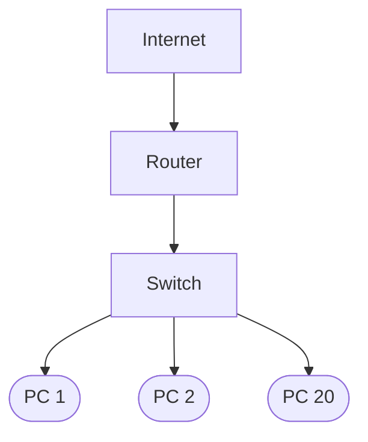

# Redes: Practico N°2

### Pregunta 1: Asignar direcciones IP a una nueva aula

**Escenario:** La escuela construyó una nueva aula de computación que necesita 30 computadoras conectadas a la red. El administrador de red te asigna la red 192.168.10.0/24.  

**Se pide:** Explicar cuál es la función de una dirección IP en una red de computadoras.Diseñar un plan de asignación de IP para las 30 computadoras (escribir al menos 3 ejemplos con dirección IP, máscara de subred y puerta de enlace / gateway).Indicar si 192.168.10.0 pertenece a IPv4 o IPv6, y comparar ambos protocolos en cuanto a longitud de la dirección (bits) y formato de escritura.

1. Una direccion IP es un identificador numerico que permite reconocer a cada dispositivo dentro de una red y tambien permite la comunicacion entre ellos.

2.
| IP | Mascara | Gateway |
| --- | --- | --- |
| 192.168.10.2 | 255.255.255.0 | 192.168.10.1 |
| 192.168.10.3 | 255.255.255.0 | 192.168.10.1 |
| ... | ... | ... |
|192.168.10.30|255.255.255.0| 192.168.10.1 |

3. La direccion 192.168.10.0 pertenece a IPv4. Esta utiliza direcciones de 32 bits y se escribe en formato decimal, mientras que IPv6 utiliza 128 bits y se escribe en formato hexadecimal.

---
### Pregunta 2: ¿Por qué se necesita IPv6?

**Escenario:** La escuela suma cada vez más dispositivos a la red (computadoras, tablets, cámaras de seguridad, impresoras, etc.) y el administrador advierte que las direcciones IPv4 disponibles a nivel mundial se están agotando. 

**Se pide:** Explicar cuántas direcciones IPv4 existen aproximadamente (en cantidad total) y por qué se están agotando.Escribir un ejemplo válido de dirección IPv4 y un ejemplo de dirección IPv6.Explicar de qué manera IPv6 resuelve el problema de la escasez de direcciones IP.

1. Existen aproximadamente 4.300 millones de direcciones IPv4. Estas se están agotando porque cada vez hay más dispositivos conectados a Internet, como computadoras, celulares, televisores y otros equipos, y la cantidad de direcciones IP es limitada.

2. **IPv4:** 192.168.10.5.   **IPv6:** 2001:0db8:85a3:0000:0000:8a2e:0370:7334

3. IPv6 utiliza direcciones de 128 bits, que permite aproximadamente 340 undecillones (o 2¹²⁸) direcciones posibles, una cantidad mucho mayor que la de IPv4, lo que permite identificar una cantidad mucho mayor de dispositivos.

---
### Pregunta 3: ¿Qué tipo de red es la red escolar?

**Escenario:** Una escuela técnica cuenta con 3 edificios: Aulas, Taller y Administración. La distancia máxima entre edificios es de aproximadamente 800 metros.  

**Se pide:** Según su cobertura geográfica, determinar si esta red escolar es LAN, MAN o WAN, y justificar la respuesta. Si se deben conectar las computadoras dentro de un mismo edificio, ¿qué medio de conexión conviene utilizar? ¿Y para interconectar los tres edificios entre sí? Comparar brevemente las topologías Bus, Estrella y Anillo. ¿Cuál es la más adecuada para la red de esta escuela y por qué?

1. Es una red LAN (Local Area Network o red de area local) porque conecta computadoras dentro de un area pequeña.

2. Conviene utilizar cables UTP para conectar dentro de un mismo edificio. Para interconectar los tres edificios conviene utilizar fibra óptica.

3. **Bus:** todos los dispositivos se conectan a un único cable principal. **Estrella:** todos los dispositivos se conectan a un dispositivo central, como un switch. **Anillo:** los dispositivos se conectan y forman un circuito cerrado.

4. La topologia de Estrella es la mas adecuada para la escuela porque permite conectar las 30 computadoras a un switch, facilita agregar nuevos equipos y tambien la detección de fallas.

---
### Pregunta 4: ¿Conexión por cable o inalámbrica?

**Escenario:** La biblioteca de la escuela necesita conectarse a Internet. Una parte del espacio cuenta con escritorios fijos con computadoras de escritorio, y otra zona está destinada a estudiantes que utilizan sus propios dispositivos móviles (celulares, notebooks, tablets). 

**Se pide:** Recomendar el tipo de conexión adecuado (cableada o inalámbrica) para la zona fija y para la zona móvil, justificando cada elección. Mencionar al menos dos tecnologías o frecuencias de transmisión inalámbrica.¿Qué desventajas presenta una red inalámbrica frente a una red cableada en términos de velocidad, latencia e interferencias?

1. Es mejor la conexion inalambrica ya que hay varios dispositivos que no pueden conectarse por cable.

2. **Wi-Fi:** utiliza frecuencias de 2,4 GHz, 5 GHz y, en estandares mas recientes, 6 GHz para conectar dispositivos de forma inalambrica. **Bluetooth:** utiliza la frecuencia de 2,4 GHz para conectar dispositivos cercanos, como teclados, auriculares y celulares.

3. **Velocidad:** puede ofrecer velocidades más variables y menores debido a la distancia al router y a la cantidad de dispositivos conectados. **Latencia:** suele tener una latencia mayor y menos estable. **Interferencias:** puede sufrir interferencias de otros dispositivos, paredes y redes Wi-Fi cercanas.

---
### Pregunta 5: ¿Qué equipos comprar para el taller?

**Escenario:** La escuela quiere armar la red de un taller informático con 20 computadoras. Todas deben comunicarse entre sí en la red local y tener acceso a Internet. Te asignan la tarea de especificar la compra de los equipos de red. 

**Se pide:** ¿Qué equipo de interconexión se necesita para conectar las 20 computadoras en la red local? Explicar su función principal.¿Qué equipo adicional se requiere para brindar acceso a Internet a esa red local? Explicar en qué se diferencia del equipo anterior. Dibujar o describir textualmente un esquema simple indicando cómo se conectan las computadoras, el switch, el router y la conexión hacia Internet.

1. El equipo para conectar es el switch y su principal función es recibir los cables de las computadoras y repartir los datos solo al equipo correspondiente.

2. Se necesita un router, que conecta la red local con otras redes. La diferencia principal es que el switch conecta los dispositivos dentro de la red local, mientras que el router permite la comunicación entre redes diferentes.

3.

---
### Pregunta 6: Diferencia entre Switch y Router

**Escenario:** En la sala de profesores, las computadoras pueden hacer ping entre sí dentro de la red local, pero ninguna logra navegar en Internet. 

**Se pide:** Explicar con tus palabras la diferencia clave entre la función de un Switch (Capa 2) y la de un Router (Capa 3). Según el escenario planteado, ¿en cuál de los dos equipos (o en su configuración/puerta de enlace) es más probable que se encuentre la falla? Justificar. Describir brevemente cómo trabajan juntos el switch y el router en una red institucional real.

1.  La diferencia es que el switch conecta dispositivos dentro de una misma red local y utiliza direcciones MAC para enviar los datos al dispositivo correspondiente. El router conecta redes y utiliza direcciones IP para dirigir los paquetes hacia su destino.

2. Es mas probable que la falla se encuentre en el router, porque como las computadoras pueden hacerse ping entre sí dentro de la red local, el switch parece estar funcionando correctamente.

3. En una red escolar, las computadoras se conectan al switch, que permite la comunicación entre los equipos, el switch se conecta al router, y permite que las computadoras accedan a internet.

---
### Pregunta 7: ¿Qué cable usar para interconectar edificios?

1. El cable UTP no es adecuado porque tiene un alcance maximo de 100 metros por enlace. Si se supera esa distancia, la señal podria perder calidad y la comunicación deja de ser garantizada.

2. Se recomienda usar fibra optica porque tiene un mayor alcance y es inmune a las interferencias electromagnéticas.

3. La fibra monomodo es la opcion más recomendable porque admite distancias mas mayores y ofreceria una posibilidad de ampliacion si se requiere.

---
### Pregunta 8: Fundamentos de la Fibra Óptica

1. La fibra óptica transporta señales luminosas y al transmitir luz y no corriente eléctrica y carecer de componentes metálicos conductores, no sufre interferencias electromagnéticas, y puede transmitir datos a varios km de distancia.

2. **Conector SC:** Conector de cuerpo rectangular de presión, ampliamente difundido en instalaciones de telecomunicaciones. **Conector LC:** Conector de tamaño pequeño con acoplamiento tipo push-pull.

---
### Pregunta 9: Planificación del cableado estructurado

1. Segun la norma ANSI/TIA-568, el cableado horizontal de cobre tiene una longitud maxima de 100 metros en total, incluyendo 90 metros para el cableado fijo instalado en paredes y 10 metros en total para los patch cords.

2. Se recomienda instalar al menos dos tomas de red RJ-45 por puesto de trabajo.

3. El Patch Panel es un panel que organiza y concentra las conexiones de los cables de red. Facilita el mantenimiento por su fácil localización si tenemos problemas sin tener que manipular todo el cableado instalado.

---
### Pregunta 10: Diagnóstico de fallas en la red

1. **Capa Fisica:** revisar el cable de red. **Capa de enlace:** revisar el sistema operativo. **Capa de red:** verificar que la conexion IP sea correcta.

2. Si la computadora responde al ping 127.0.0.1 o a su propia IP, pero no logra comunicarse con la puerta de enlace, el problema puede estar en la conexion entre la computadora y/o la red local.

3. Comando `ipconfig`, muestra el IP, la puerta de enlace y la mascara.
