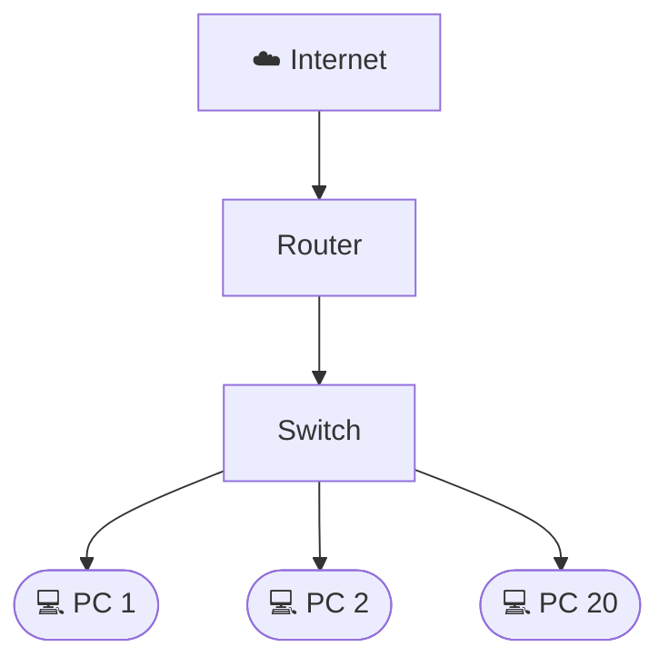

**Pregunta 1: Asignar direcciones IP a una nueva aula**

1. Una direccion IP es un identificador numerico que permite reconocer a cada dispositivo dentro de una red y tambien permite la comunicacion entre ellos.

2.
| IP | Mascara | Gateway |
| --- | --- | --- |
| 192.168.10.2 | 255.255.255.0 | 192.168.10.1 |
| 192.168.10.3 | 255.255.255.0 | 192.168.10.1 |
| ... | ... | ... |
|192.168.10.30|255.255.255.0| 192.168.10.1 |

3. La direccion 192.168.10.0 pertenece a IPv4. Esta utiliza direcciones de 32 bits y se escribe en formato decimal, mientras que IPv6 utiliza 128 bits y se escribe en formato hexadecimal.

---
**Pregunta 2: ¿Por qué se necesita IPv6?**

1. Existen aproximadamente 4.300 millones de direcciones IPv4. Estas se están agotando porque cada vez hay más dispositivos conectados a Internet, como computadoras, celulares, televisores y otros equipos, y la cantidad de direcciones IP es limitada.

2. **IPv4:** 192.168.10.5, **IPv6:** 2001:0db8:85a3:0000:0000:8a2e:0370:7334

3. IPv6 utiliza direcciones de 128 bits, que permite aproximadamente 340 undecillones (o 2¹²⁸) direcciones posibles, una cantidad muchísimo mayor que la de IPv4, lo que permite identificar una cantidad mucho mayor de dispositivos.

---
**Pregunta 3: ¿Qué tipo de red es la red escolar?**

1. Es una red LAN (Local Area Network o red de area local) porque conecta computadoras dentro de un area pequeña.

2. Conviene utilizar cables UTP para conectar dentro de un mismo edificio. Para interconectar los tres edificios conviene utilizar fibra óptica.

3. **Bus:** todos los dispositivos se conectan a un único cable principal. **Estrella:** todos los dispositivos se conectan a un dispositivo central, como un switch. **Anillo:** los dispositivos se conectan y forman un circuito cerrado.

4. La topologia de Estrella es la mas adecuada para la escuela porque permite conectar las 30 computadoras a un switch, facilita agregar nuevos equipos y tambien la detección de fallas.

---
**Pregunta 4: ¿Conexión por cable o inalámbrica?**

1. Es mejor la conexion inalambrica ya que hay varios dispositivos que no pueden conectarse por cable.

2. **Wi-Fi:** utiliza frecuencias de 2,4 GHz, 5 GHz y, en estandares mas recientes, 6 GHz para conectar dispositivos de forma inalambrica. **Bluetooth:** utiliza la frecuencia de 2,4 GHz para conectar dispositivos cercanos, como teclados, auriculares y celulares.

3. **Velocidad:** puede ofrecer velocidades más variables y menores debido a la distancia al router y a la cantidad de dispositivos conectados. **Latencia:** suele tener una latencia mayor y menos estable. **Interferencias:** puede sufrir interferencias de otros dispositivos, paredes y redes Wi-Fi cercanas.

---
**Pregunta 5: ¿Qué equipos comprar para el taller?**

1. El equipo para conectar es el switch y su principal función es recibir los cables de las computadoras y repartir los datos solo al equipo correspondiente.

2. Se necesita un router, que conecta la red local con otras redes. La diferencia principal es que el switch conecta los dispositivos dentro de la red local, mientras que el router permite la comunicación entre redes diferentes.

3.

---

**6)** El que se usa para salir a internet es el **Router**. El router se encarga de unir la red local con la red externa.

---

**7)** Se usa fibra óptica, también el cable UTP, y el Coaxial Monomodo, sirve para exteriores en edificios.

---

**8)** **Fibra Óptica** transporta señal luminosa. La fibra óptica al transmitir luz y no corriente eléctrica y carecer de componentes metálicos conductores, no sufre interferencias electromagnéticas.

* **Conector SC:** Conector de cuerpo rectangular de presión, ampliamente difundido en instalaciones de telecomunicaciones.
* **Conector LC:** Conector de tamaño pequeño con acoplamiento tipo push-pull.

---

**4)** Es mejor la conexión inalámbrica ya que hay varios dispositivos que no pueden conectarse por cable.

---

**9)** El **Patch Panel** es un panel que organiza y concentra las conexiones de los cables de red. Facilita por su fácil localización si tenemos problemas sin tener que manipular todo el cableado instalado.

---

**10)** 
* **Física**
  1. Revisar el cable de red.
* **Enlace**
  2. Revisar el sist operativo.
* **Red**
  3. Verificar la dirección IP, que sea correcta.
  * Comando `ipconfig` – IP, puerta de enlace y la máscara.
